<div align="center">

🇬🇧 **English** · 🇳🇱 [Nederlands](README.nl.md)


# 3D Print Pricing

**A self-hosted app for 3D-print businesses: work out what a print really costs, keep track of your filament stock, and turn customer orders into invoices.**

[](#install-as-an-app)
[](#installation-self-hosted)
[](#features)
[](#)

[Operations guide (Dutch)](docs/handleiding.md) · [Working conventions](AGENTS.md) · [Docs](docs/)

</div>

---

## Screenshots

<picture>
  <source media="(prefers-color-scheme: dark)" srcset="docs/assets/desktop-calculation-dark.png">
  
</picture>

### Desktop

| 3D Models | Filament stock | Orders |
|:---:|:---:|:---:|
|  |  |  |

### iPhone: the iOS-style look

The floating, glass-like navigation bar. Installed on the home screen it runs full screen under the status bar.

| 3D Models | Cost price | Orders | Filament |
|:---:|:---:|:---:|:---:|
|  |  |  |  |

### Android: the Android-style look

The full-width navigation bar with a pill behind the active icon.

| 3D Models | Cost price | Orders | Filament |
|:---:|:---:|:---:|:---:|
|  |  |  |  |

### Settings and your own colour

*Settings* is grouped into *Personal*, *Data* and *Administration*, each part with an icon (what you see depends on your role). On a phone the parts form a row you swipe. Under *Display* you choose the language, light or dark, and your **accent colour**: eleven presets, bordeaux and graphite among them, or any colour of your own. The whole interface follows it, not only the buttons. On *Filaments*, the Spoolman and *Import and share* blocks fold away.

| Display: light, with the default violet | Display: dark, with teal |
|:---:|:---:|
| 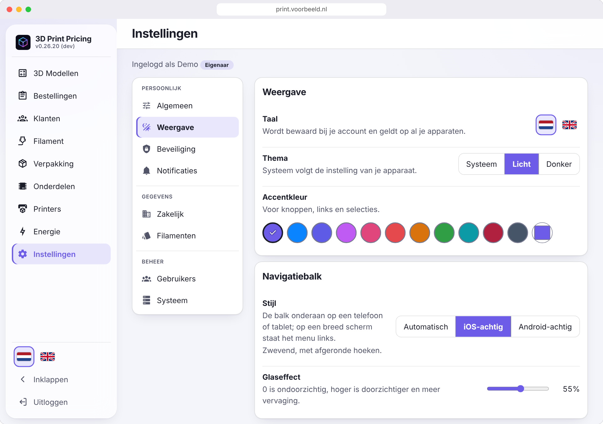 | 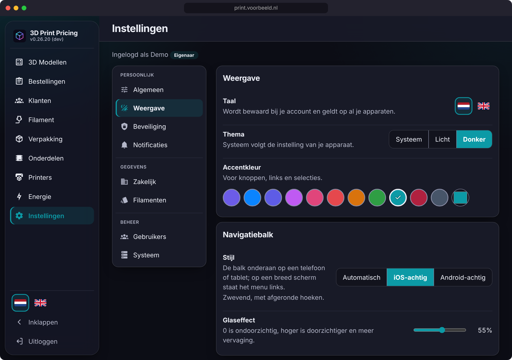 |

| iPhone: settings | Android: settings |
|:---:|:---:|
| 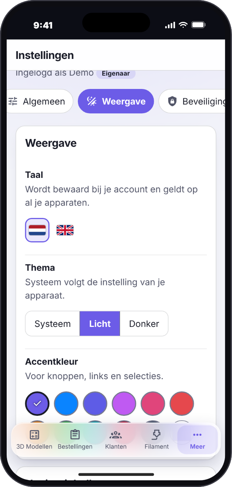 | 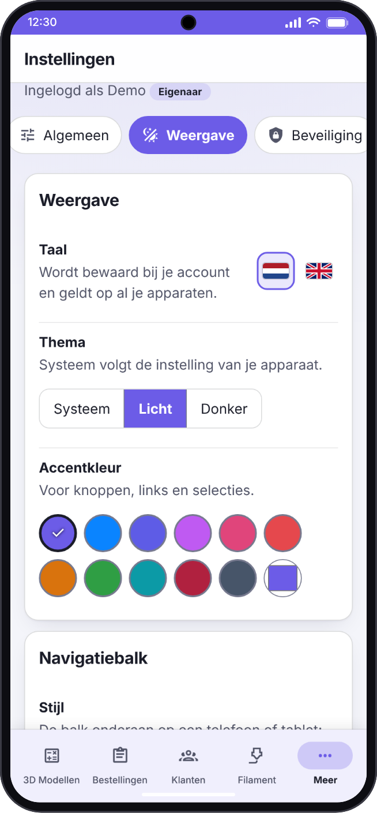 |

### Filament: library, import and new rolls

*Settings → Filaments* holds the filament library: add a filament, import a Bambu Lab invoice, add the rolls of your filament list, import or export the library as JSON, sync it from GitHub, or contribute your filaments to the central library through a pre-filled GitHub issue. Under *Filament → New roll* you create a roll, either by hand, by scanning its barcode or by picking a filament from the library.

| Library: import, export and sync | New roll |
|:---:|:---:|
| 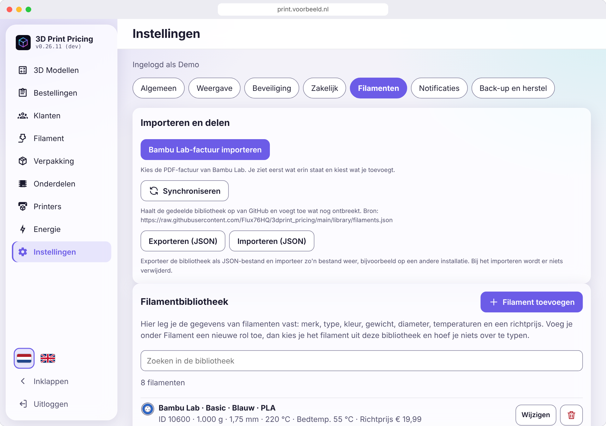 | 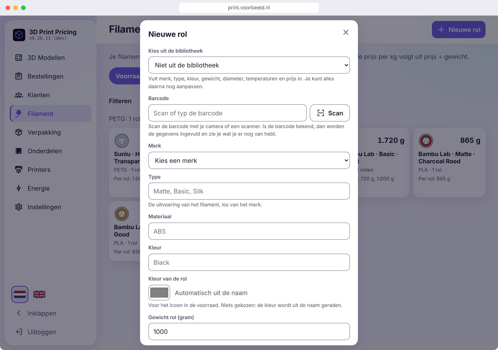 |

| iPhone: library | iPhone: new roll | Android: library | Android: new roll |
|:---:|:---:|:---:|:---:|
| 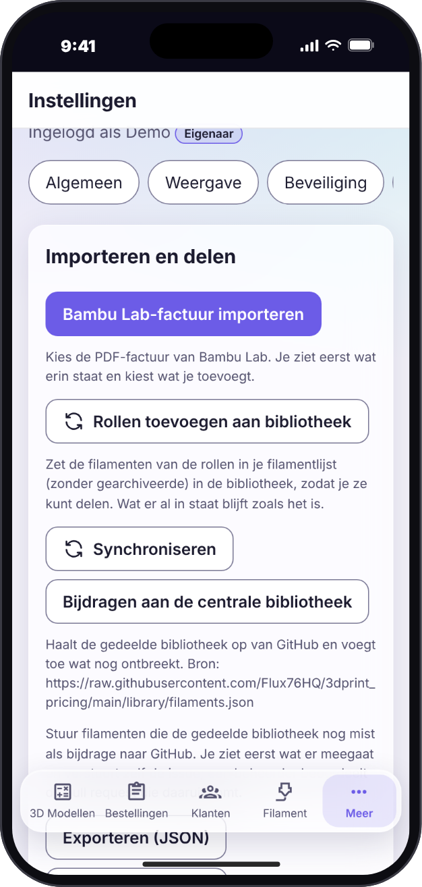 | 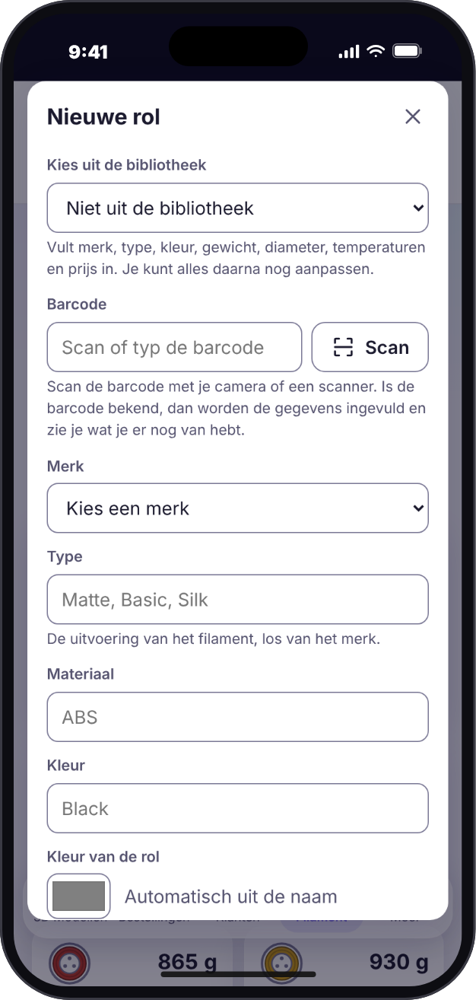 | 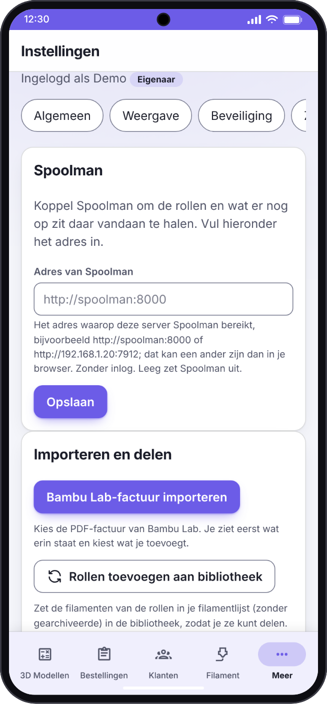 | 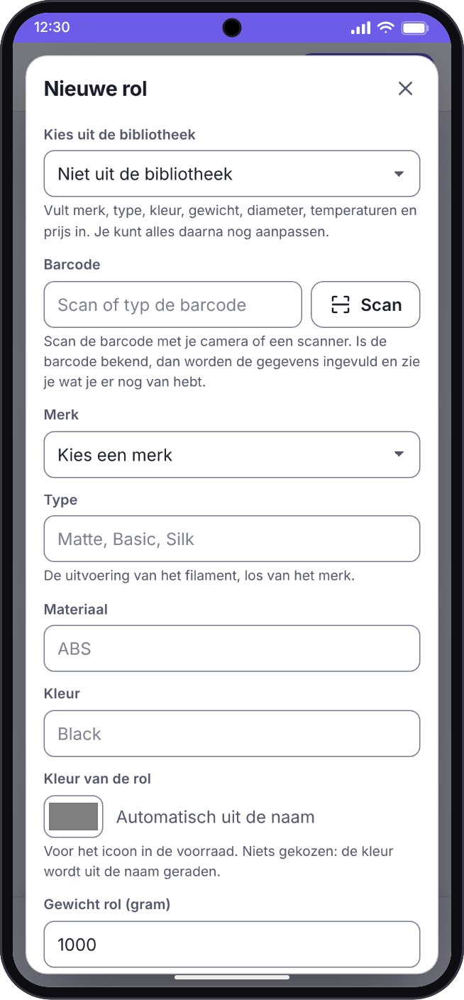 |

Under *Settings → Display → Navigation bar*, choose iOS-style or Android-style, or leave it on *Automatic*: the app detects the device and defaults to Android-style on Android and iOS-style elsewhere. Your choice is saved with your account and applies on all your devices. Light, dark and system themes and your own accent colour are included.

<sub>The screenshots show demo data.</sub>

## Why 3D Print Pricing?

Selling 3D prints means knowing what each one costs: filament by the gram, machine time, electricity, packaging and a fair share of the printer's purchase price. A spreadsheet gets you there, until the prices change, the stock runs out unnoticed, or a customer wants an invoice. 3D Print Pricing keeps the prices, the stock and the orders in one place that you host yourself, and works from your phone as well as your desk.

## Features

- **Cost price in seconds**: filament, parts, accessories (cables, chargers), printer depreciation and energy add up to a cost price, with an optional margin for a recommended selling price. Every line is rounded to the cent first, so the lines on screen add up to the total.
- **Straight from the slicer**: attach a `.3mf` or `.stl` file. A sliced 3MF (Bambu Studio / Orca) gives the real grams per filament and the print time, which go into the calculation automatically; an STL gives a weight estimate.
- **Filament library**: keep the specs of the filaments you buy (brand, type, colour, supplier filament ID, weight, diameter, temperatures, indicative price) in a library, so a new roll fills itself in. Add a filament by hand with *Add filament*, or fill the library without typing: **import** a Bambu Lab invoice (PDF, barcodes included), **import** a JSON file, or **sync** the shared library from GitHub. **Export** the library as JSON to back it up or move it to another installation. JSON import and sync only add and update, never delete, and ask for confirmation with the numbers first; the library never holds the same filament twice and is separate from your stock.
- **Filament stock with barcode scanning**: your rolls with price, remaining weight, colour and temperatures, grouped per kind. **Create a new roll** by hand, by scanning its barcode (a known roll fills itself in), by picking a filament from the library, or, for Bambu Lab, by choosing the product and colour from the web shop; a new roll can also add its filament to the library. Get a notification when a kind is nearly out, and book the usage of a calculation off the stock with one click.
- **Prices that stay put**: a saved calculation keeps the prices of the moment you saved it, so changing a roll price later never rewrites your history.
- **Business-ready**: VAT on the selling price, a margin and a price rounding per order (to 5/10/50 cents, whole euros, or ending in ,95/,99, with your margin as the minimum), and a button to blur the costs when a customer looks over your shoulder.
- **Customers, orders and invoices**: customers with a customer number, orders with several prints each, a status from *new* to *completed*, and a PDF invoice with your logo, a unique invoice number and a SEPA payment QR code. Bring your own Word or PDF letterhead if you like.
- **Passkey login**: no password to leak. Optional password with two-step verification, and recovery codes for emergencies.
- **More than one person**: an administrator invites people with a one-time link, and each chooses their own passkey or password, so nobody ever knows anyone else's. Regular users do the daily work; an administrator also manages users, the company details, backups and updates, and can promote a regular user to administrator.
- **A real app on every device**: installs on the iPhone and Android home screen and on the desktop, works with the camera and with notifications, and speaks Dutch and English.
- **Your data, your server**: backup and restore of everything from within the app, and your data stays on your own server. *Settings → System* can also put the app back to a new installation: it deletes everything in the database and the uploads (the passkeys too) after a typed word and a fresh passkey (or password and code) confirmation, and leaves `.env`, the image and `DATA_PATH/backups` alone. Make a backup first if you are not sure.

The full description of every feature is in the [operations guide](docs/handleiding.md) (Dutch).

## Getting started

### Users

- 🌐 **Web:** open the address of your own installation. Passkeys need https and a domain name.
- 📱 **iPhone / iPad:** see [Install as an app](#install-as-an-app).
- 🤖 **Android:** see [Install as an app](#install-as-an-app).
- 🐳 **Self-hosted:** see [Installation](#installation-self-hosted).

### Install as an app

- **Android (Chrome, Edge, Samsung Internet) and desktop:** open the https address and choose *Install app* in the prompt, or under *Settings → General → Install app*. Long-press the icon for shortcuts (new calculation, filament).
- **iPhone / iPad:** open the https address in **Safari → Share → Add to Home Screen**. The app then starts full screen with its own icon and launch screen, without pinch-zoom or sideways swiping, like a native app.

### Installation (self-hosted)

```bash
git clone https://github.com/Flux76HQ/3dprint_pricing.git
cd 3dprint_pricing
python scripts/init_env.py --port 6090 --domain print.example.com   # creates .env with fresh secrets
docker compose up -d
```

`init_env.py` is the easy route; copying `.env.example` to `.env` and editing it works just as well. A server only needs `docker-compose.yml` and `.env`: the image is pulled from `ghcr.io/flux76hq/3dprint_pricing`. Without `--domain` the app is set up for `http://localhost:<port>`, enough to try it out.

Then open the address and go through the onboarding:

1. Enter the **setup code** and your name. The setup code is the value after `SETUP_CODE=` in the `.env` file on your server (`init_env.py` printed it too; `grep SETUP_CODE .env` shows it again). Type or paste it into the *Setup code* field of the first screen; you only need it for this first setup, afterwards you sign in with your passkey. The onboarding screen explains this as well.
2. Create your **passkey** (fingerprint, face or device code).
3. **Save the 8 recovery codes.** They are shown once and each works once.

Put a reverse proxy with TLS in front of the app and set `RP_ID` and `RP_ORIGINS` to that domain: passkeys, installing, the camera and notifications only work over https (except on `localhost`).

### Installation as a Home Assistant app

On Home Assistant OS or Supervised, add `https://github.com/Flux76HQ/3dprint_pricing` under **Settings > Apps > Install app > Repositories** and install
*3D Print Pricing*: the app brings its own PostgreSQL and keeps its data in the app's folder, which Home Assistant backs up. Passkeys still need a
domain with https in front of the app's port, so set `rp_id` on the Configuration tab. The steps are on the app's Documentation tab ([`homeassistant/DOCS.md`](homeassistant/DOCS.md)). Amd64 only for now.

### Configuration

Set in `.env`; the file `.env.example` documents each value.

| Variable | Required | Default | Description |
|---|:---:|---|---|
| `WEB_PORT` | ✅ | - | Port of the app; compose publishes it and the app listens on it |
| `DATA_PATH` | ✅ | - | Host folder for all data: the database (`postgres/`) and the uploaded files (`uploads/`). Plain folders, not Docker volumes. Must be an **absolute** folder of the Docker host (e.g. `/srv/printpricing`, on Unraid `/mnt/user/appdata/printpricing`), never `./data`; data that ended up elsewhere is moved by `scripts/migrate_data.sh` |
| `POSTGRES_USER` / `POSTGRES_PASSWORD` / `POSTGRES_DB` | ✅ | - | The database; use letters and digits only in the password |
| `RP_ID` | ✅ | - | Domain the app runs on, without scheme or port. Passkeys are bound to it |
| `RP_ORIGINS` | ✅ | - | Full origin(s), comma separated, for example `https://print.example.com`. Invitation links use the address the administrator is signed in on when it is listed here, otherwise the first one |
| `SETUP_CODE` | ✅ | - | One-time code for the onboarding, so the first visitor cannot take over the app |
| `SESSION_SECRET` | ✅ | - | Signs session cookies, at least 32 characters |
| `RP_NAME` | ❌ | `3D Print Pricing` | Name shown in the passkey prompt |
| `SESSION_HOURS` | ❌ | `24` | Lifetime of a session |
| `MAX_UPLOAD_MB` | ❌ | `50` | Largest STL/3MF upload in MB |
| `VAPID_PUBLIC_KEY` / `VAPID_PRIVATE_KEY` | ❌ | empty | Key pair for push notifications (`python scripts/generate_vapid.py`); empty means notifications are off |
| `VAPID_SUBJECT` | ❌ | `mailto:admin@<RP_ID>` | Contact address for the push services |
| `AI_IMAGES_ENABLED` | ❌ | `FALSE` | Set to `TRUE` to show the optional *AI images* feature (product pictures from a photo, made with OpenAI GPT Image). The API key is entered in the app under Settings, not in `.env` |
| `FILAMENT_LIBRARY_URL` | ❌ | this repository's `library/filaments.json` | Where *Settings → Filaments → Sync* reads the shared filament library from: a JSON file in the format of the library export, on `raw.githubusercontent.com`. Empty switches the Sync button off |
| `SPOOLMAN_URL` | ❌ | empty (type it in the app) | The address of your [Spoolman](https://github.com/Donkie/Spoolman) as the app's container reaches it, e.g. `http://spoolman:8000` (no login). With it, *Settings → Filaments → Sync* reads the rolls and what is left on them from Spoolman, booked filament is reported back, and the library and your own rolls can be pushed to it. Leave it empty to type the address in the app instead (administrators, *Settings → Filaments*); when it is set here, it wins and the app shows it read-only |
| `PROXY_HOPS` | ❌ | `0` | Number of reverse proxies in front of the app |
| `WEB_CONCURRENCY` | ❌ | `2` | Number of Gunicorn workers |
| `PRINTPRICING_UPDATE_CHECK` | ❌ | `true` | The update check: the app asks GitHub whether a newer stable release exists and tells the owner with a banner and under *Settings → System → Update check*. It sends nothing about your installation and never updates anything. `false` (also `0`, `no`, `off`) switches it off, for an installation that must not call out. A beta build only sees stable releases |
| `PRINTPRICING_TAG` | ❌ | `latest` | Which build runs: `latest` (stable), `beta` (the development version) or a version number such as `0.26.15`. `docker-compose.yml` pulls `ghcr.io/flux76hq/3dprint_pricing:<tag>` and passes the same value to the app, which shows a **beta** label next to its name on `beta`. Replaces `APP_IMAGE` |

Updating is `docker compose pull && docker compose up -d` (or `sh scripts/update.sh`, which dumps the database first). The app tells you when a newer release exists: it asks GitHub (the latest stable release of this repository, nothing about your installation is sent) and shows a banner and *Settings → System → Update check*; it only announces, it never updates anything. `PRINTPRICING_UPDATE_CHECK=false` switches it off. Health checks, backups, notifications and everything else about running the app are in the [operations guide](docs/handleiding.md) (Dutch).

## Tech stack

- **App / frontend:** a Progressive Web App in plain JavaScript, no build step, with a service worker for the offline shell
- **Backend:** Python, Flask and Gunicorn; passkeys through the open-source `py_webauthn` library (`webauthn` package)
- **Database:** PostgreSQL 17, with forward-only, checksum-guarded migrations
- **Infrastructure:** Docker Compose, an image published to GHCR by CI

## Architecture

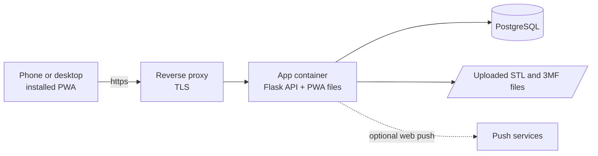

## Contributing

Contributions are welcome. Pull requests go to the `beta` branch, never directly to `main`; `main` is the stable line and only receives a promotion pull request from `beta`. The working conventions for people and AI assistants alike are in [AGENTS.md](AGENTS.md): versioning, local checks, tests and the pull request workflow. For bugs and ideas, open an [issue](https://github.com/Flux76HQ/3dprint_pricing/issues/new).

```bash
python -m venv .venv && . .venv/bin/activate
pip install -r backend/requirements-dev.txt
python scripts/setup_hooks.py
cd backend && PYTHONPATH=. python -m pytest -q
```

The screenshots above are generated from a demo instance: after a change that alters how a screen looks, run `pip install playwright && python scripts/generate_screenshots.py` and commit the updated images in `docs/assets/`.

### Stable and beta

| | Stable | Beta |
|---|---|---|
| Branch | `main` | `beta` |
| Image | `ghcr.io/flux76hq/3dprint_pricing:latest` (and `X.Y.Z`) | `ghcr.io/flux76hq/3dprint_pricing:beta` |
| GitHub release | `vX.Y.Z` | none |

Every change lands in `beta` first, and every push to `beta` builds a new beta image. Only when the beta proves itself is it promoted to `main`, which raises `VERSION` and builds `latest` and the release. To try the beta, set `PRINTPRICING_TAG=beta` in `.env` (the app then shows a **beta** label next to its name) and run `docker compose pull && docker compose up -d`; use a separate data folder for it.

## Privacy & security

- Everything is stored on your own server: there is no account with us, no analytics and no tracking.
- Signing in uses passkeys; the app never sees a password unless you switch the optional password login on.
- Backups never contain credentials (passkeys, recovery codes, passwords, push subscriptions) or invitations. An invitation link is shown once and only its hash is stored.
- Report security issues to the maintainers directly (see Contact) rather than in a public issue.

## Contact

**Flux76HQ** · [@Flux76HQ](https://github.com/Flux76HQ)

---

<div align="center">
<sub>Made with ❤️ in the Netherlands</sub>
</div>
