<div align="center">

🇬🇧 [English](README.md) · 🇳🇱 **Nederlands**

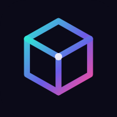

# 3D Print Pricing

**Een zelf-gehoste app voor wie 3D-prints verkoopt: reken uit wat een print echt kost, houd je filamentvoorraad bij en maak van bestellingen facturen.**

[](#installeren-als-app)
[](#installatie-self-hosted)
[](#functies)
[](#)

[Handleiding](docs/handleiding.md) · [Werkafspraken](AGENTS.md) · [Documentatie](docs/)

</div>

---

## Screenshots

<picture>
  <source media="(prefers-color-scheme: dark)" srcset="docs/assets/desktop-calculation-dark.png">
  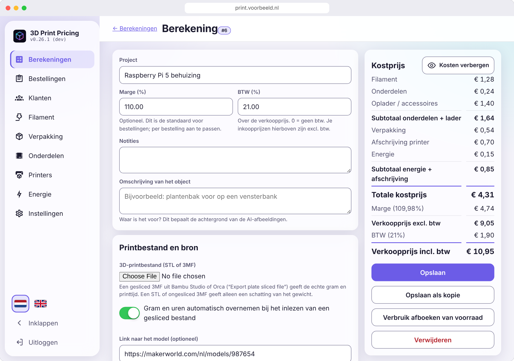
</picture>

### Desktop

| Berekeningen | Filamentvoorraad | Bestellingen |
|:---:|:---:|:---:|
| 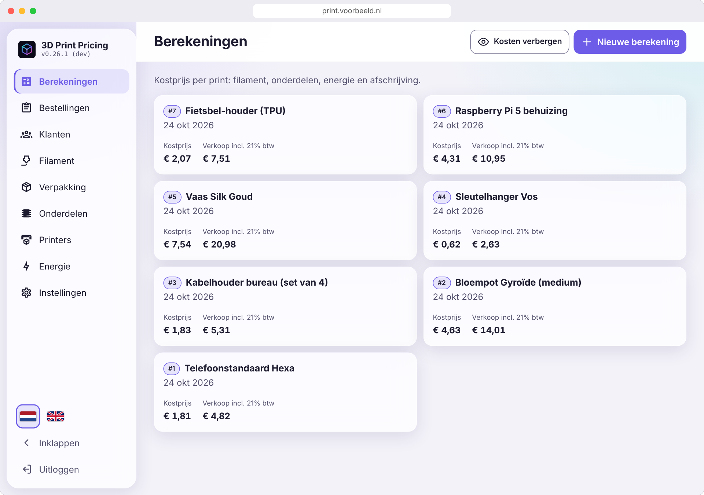 | 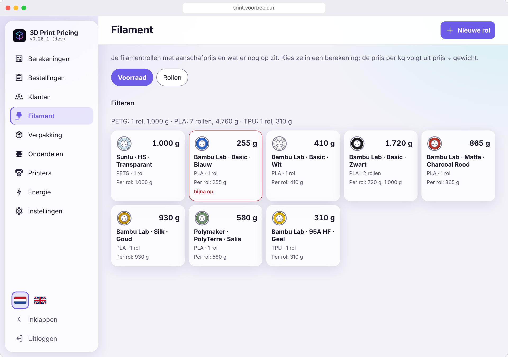 | 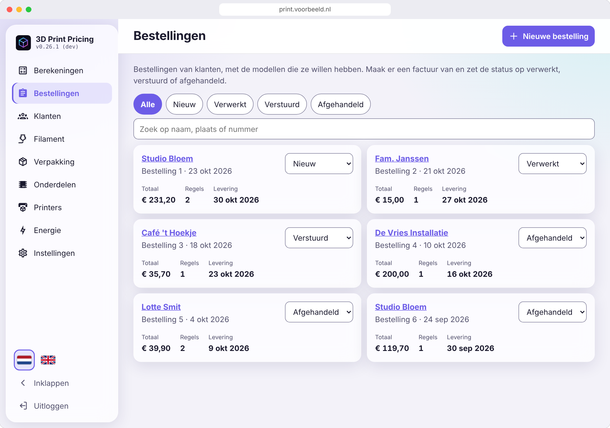 |

### iPhone: de iOS-look

De zwevende navigatiebalk met glaseffect. Op het beginscherm geïnstalleerd draait de app schermvullend onder de statusbalk.

| Berekeningen | Kostprijs | Bestellingen | Filament |
|:---:|:---:|:---:|:---:|
| 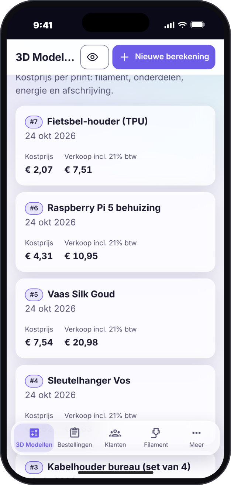 | 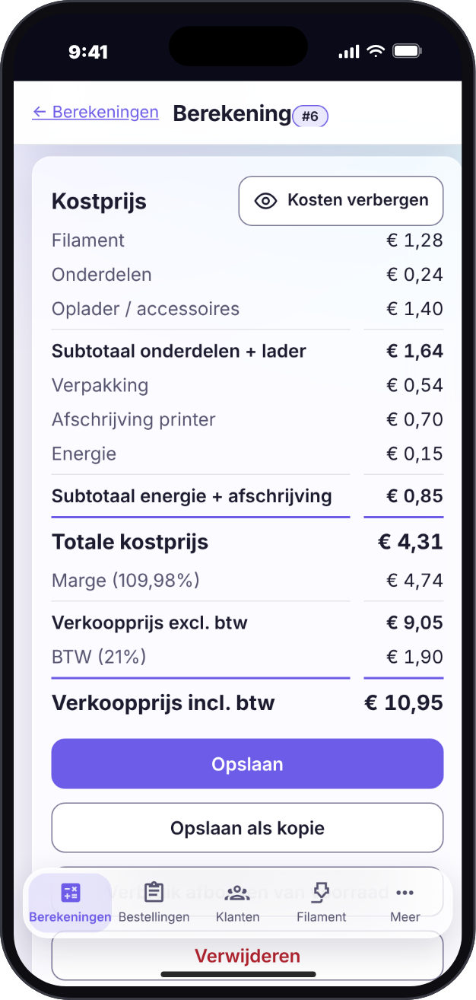 | 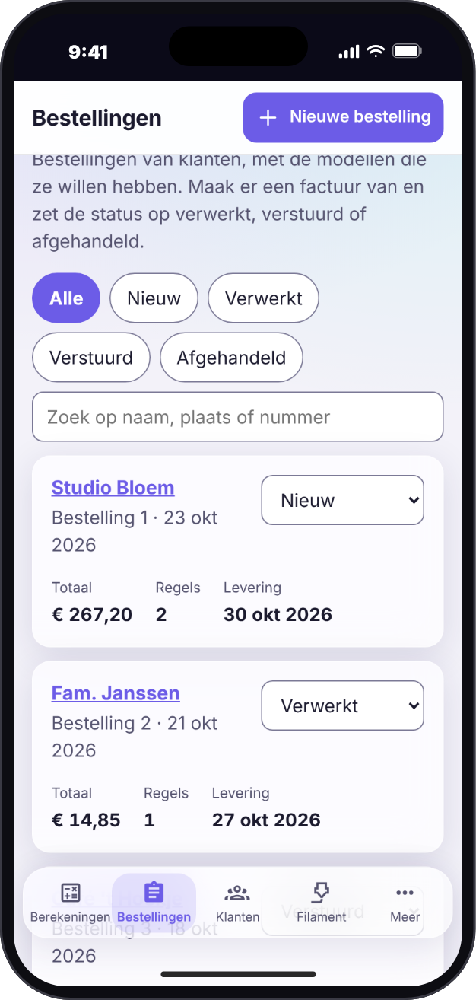 | 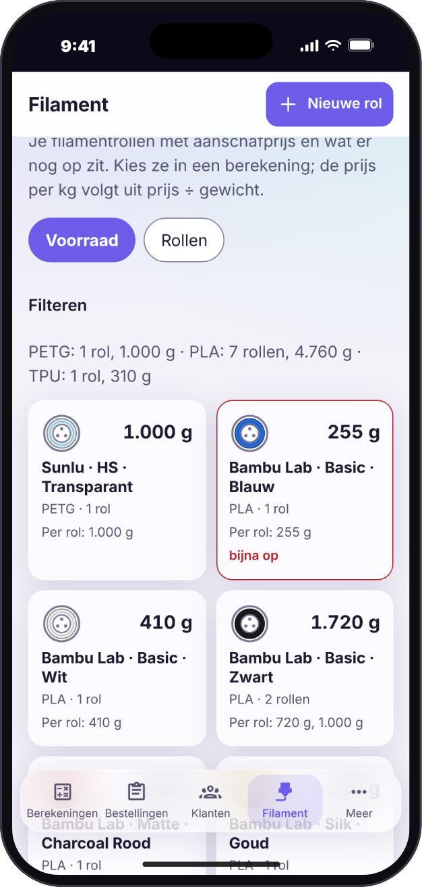 |

### Android: de Android-look

De navigatiebalk over de volle breedte met een pil achter het actieve icoon.

| Berekeningen | Kostprijs | Bestellingen | Filament |
|:---:|:---:|:---:|:---:|
| 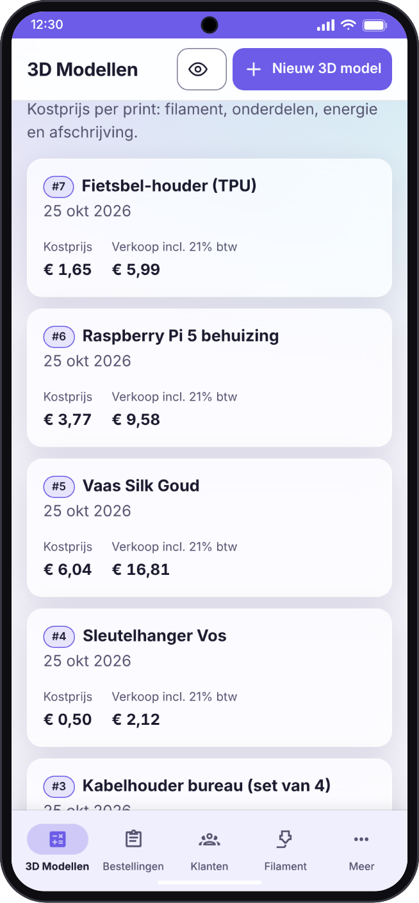 | 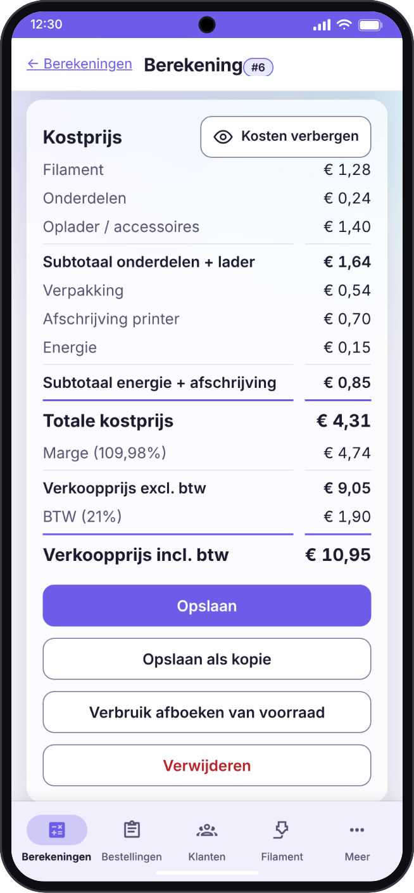 | 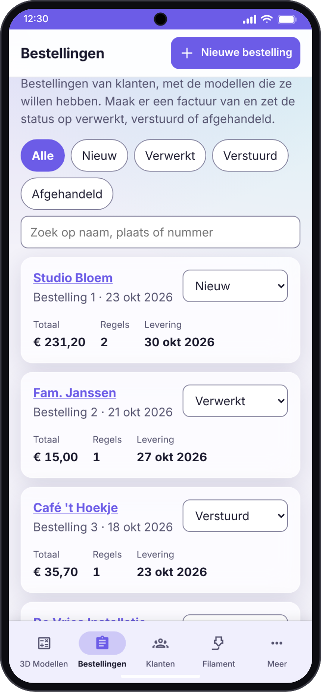 | 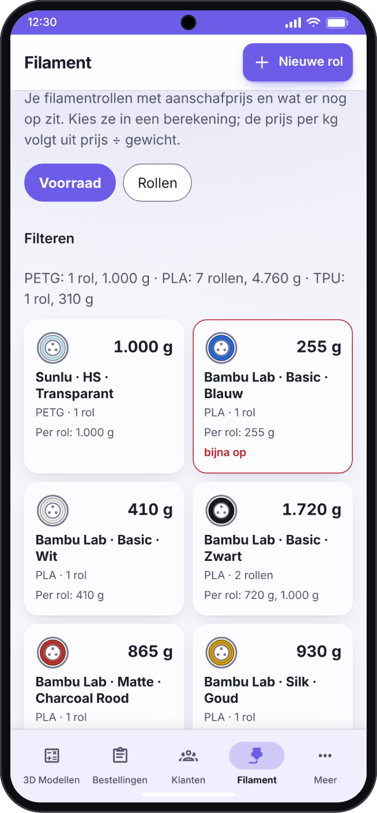 |

Onder *Instellingen → Weergave → Navigatiebalk* kies je iOS-achtig of Android-achtig, of laat je de instelling op *Automatisch*: de app herkent het toestel en kiest Android-achtig op Android en iOS-achtig op andere apparaten. Je keuze wordt bij je account bewaard en geldt op al je apparaten. Licht, donker en systeemthema en een eigen accentkleur zitten erbij.

<sub>De screenshots tonen demogegevens.</sub>

## Waarom 3D Print Pricing?

Wie 3D-prints verkoopt moet weten wat elke print kost: filament per gram, machinetijd, stroom, verpakking en een eerlijk deel van de aanschaf van de printer. Met een spreadsheet kom je een eind, tot de prijzen veranderen, de voorraad ongemerkt opraakt of een klant om een factuur vraagt. 3D Print Pricing houdt prijzen, voorraad en bestellingen bij elkaar op een plek die je zelf host, en werkt op je telefoon net zo goed als aan je bureau.

## Functies

- **Kostprijs in een paar seconden**: filament, onderdelen, accessoires (kabels, laders), verpakking, printerafschrijving en energie tellen op tot een kostprijs, met optioneel een marge voor een adviesverkoopprijs. Elke regel wordt eerst op hele centen afgerond, zodat de regels op het scherm optellen tot het totaal.
- **Rechtstreeks uit de slicer**: koppel een `.3mf`- of `.stl`-bestand. Een gesliced 3MF (Bambu Studio / Orca) geeft de echte gram per filament en de printtijd, die automatisch in de berekening komen; een STL geeft een schatting van het gewicht.
- **Filamentvoorraad met barcodescanner**: je rollen met prijs, resterend gewicht, kleur en temperaturen, gegroepeerd per soort. Scan een barcode met de camera van je telefoon en een bekende rol vult zichzelf in. Krijg een melding als een soort bijna op is en boek het verbruik van een berekening met één klik van de voorraad af.
- **Prijzen die blijven staan**: een opgeslagen berekening bewaart de prijzen van het moment van opslaan, dus een latere prijswijziging van een rol herschrijft je geschiedenis niet.
- **Zakelijk bruikbaar**: btw over de verkoopprijs, een marge en een afronding van de prijs per bestelling (op 5/10/50 cent, hele euro's of eindigend op ,95/,99, met je marge als minimum), en een knop om de kosten te blurren als een klant meekijkt.
- **Klanten, bestellingen en facturen**: klanten met klantnummer, bestellingen met meerdere prints, een status van *nieuw* tot *afgehandeld* en een factuur als PDF met je logo, een uniek factuurnummer en een SEPA-betaal-QR. Wil je je eigen briefpapier, dan kan dat als Word- of PDF-sjabloon.
- **Inloggen met passkeys**: geen wachtwoord dat kan lekken. Optioneel een wachtwoord met tweestapsverificatie, en herstelcodes voor noodgevallen.
- **Een echte app op elk apparaat**: te installeren op het beginscherm van iPhone en Android en op de desktop, werkt met de camera en met meldingen, en spreekt Nederlands en Engels.
- **Jouw gegevens, jouw server**: back-up en herstel van alles vanuit de app, en je gegevens blijven op je eigen server.

De volledige beschrijving van elke functie staat in de [handleiding](docs/handleiding.md).

## Aan de slag

### Gebruikers

- 🌐 **Web:** open het adres van je eigen installatie. Passkeys vragen https en een domeinnaam.
- 📱 **iPhone / iPad:** zie [Installeren als app](#installeren-als-app).
- 🤖 **Android:** zie [Installeren als app](#installeren-als-app).
- 🐳 **Self-hosted:** zie [Installatie](#installatie-self-hosted).

### Installeren als app

- **Android (Chrome, Edge, Samsung Internet) en desktop:** open het https-adres en kies *Installeer de app* in de melding, of onder *Instellingen → Algemeen → App installeren*. Lang drukken op het icoon geeft snelkoppelingen (nieuwe berekening, filament).
- **iPhone / iPad:** open het https-adres in **Safari → Deel → Zet op beginscherm**. De app start dan schermvullend met een eigen icoon en opstartscherm, zonder pinch-zoom of zijwaarts vegen, als een native app.

### Installatie (self-hosted)

```bash
git clone https://github.com/Flux76HQ/3dprint_pricing.git
cd 3dprint_pricing
python scripts/init_env.py --port 6090 --domain print.voorbeeld.nl   # maakt .env met verse geheimen
docker compose up -d
```

`init_env.py` is de makkelijkste weg; `.env.example` kopiëren naar `.env` en aanpassen werkt net zo goed. Een server heeft alleen `docker-compose.yml` en `.env` nodig: de image wordt van `ghcr.io/flux76hq/3dprint_pricing` gepulld. Zonder `--domain` wordt `http://localhost:<poort>` ingesteld, genoeg om het uit te proberen.

Open daarna het adres en doorloop de onboarding:

1. Vul de **setupcode** in (`SETUP_CODE` uit `.env`) en je naam.
2. Maak je **passkey** aan (vingerafdruk, gezicht of apparaatcode).
3. **Bewaar de 8 herstelcodes.** Ze worden één keer getoond en werken elk één keer.

Zet een reverse proxy met TLS voor de app en stel `RP_ID` en `RP_ORIGINS` in op dat domein: passkeys, installeren, de camera en meldingen werken alleen via https (behalve op `localhost`).

### Configuratie

Instellen in `.env`; het bestand `.env.example` documenteert elke waarde.

| Variabele | Verplicht | Standaard | Omschrijving |
|---|:---:|---|---|
| `WEB_PORT` | ✅ | - | Poort van de app; compose publiceert en de app luistert op deze waarde |
| `DATA_PATH` | ✅ | - | Map op de host voor de PostgreSQL-data (`postgres/`) en geüploade bestanden (`app/`) |
| `POSTGRES_USER` / `POSTGRES_PASSWORD` / `POSTGRES_DB` | ✅ | - | De database; gebruik een wachtwoord met alleen letters en cijfers |
| `RP_ID` | ✅ | - | Domein waarop de app draait, zonder schema of poort. Passkeys zijn eraan gebonden |
| `RP_ORIGINS` | ✅ | - | Volledige origin(s), komma-gescheiden, bijvoorbeeld `https://print.voorbeeld.nl` |
| `SETUP_CODE` | ✅ | - | Eenmalige code voor de onboarding, zodat niet de eerste bezoeker de app overneemt |
| `SESSION_SECRET` | ✅ | - | Ondertekent sessiecookies, minimaal 32 tekens |
| `RP_NAME` | ❌ | `3D Print Pricing` | Naam die in de passkey-prompt staat |
| `SESSION_HOURS` | ❌ | `24` | Levensduur van een sessie |
| `MAX_UPLOAD_MB` | ❌ | `50` | Grootste STL/3MF-upload in MB |
| `VAPID_PUBLIC_KEY` / `VAPID_PRIVATE_KEY` | ❌ | leeg | Sleutelpaar voor push-meldingen (`python scripts/generate_vapid.py`); leeg betekent meldingen uit |
| `VAPID_SUBJECT` | ❌ | `mailto:admin@<RP_ID>` | Contactadres voor de pushdiensten |
| `AI_IMAGES_ENABLED` | ❌ | `FALSE` | Zet op `TRUE` om de optionele functie *AI-afbeeldingen* te tonen (productafbeeldingen uit een foto, gemaakt met OpenAI GPT Image). De API-sleutel voer je in de app in onder Instellingen, niet in `.env` |
| `PROXY_HOPS` | ❌ | `0` | Aantal reverse proxies voor de app |
| `WEB_CONCURRENCY` | ❌ | `2` | Aantal Gunicorn-workers |
| `APP_IMAGE` | ❌ | `ghcr.io/flux76hq/3dprint_pricing:latest` | De te draaien image |

Bijwerken doe je met `docker compose pull && docker compose up -d`. Health checks, back-up, meldingen en al het andere over het draaiende houden van de app staan in de [handleiding](docs/handleiding.md).

## Tech stack

- **App / frontend:** een Progressive Web App in gewoon JavaScript, zonder buildstap, met een service worker voor de offline schil
- **Backend:** Python, Flask en Gunicorn; passkeys via een zelfgeschreven WebAuthn-implementatie
- **Database:** PostgreSQL 17, met alleen-vooruit migraties die op checksum bewaakt worden
- **Infrastructuur:** Docker Compose, een image die CI naar GHCR publiceert

## Architectuur

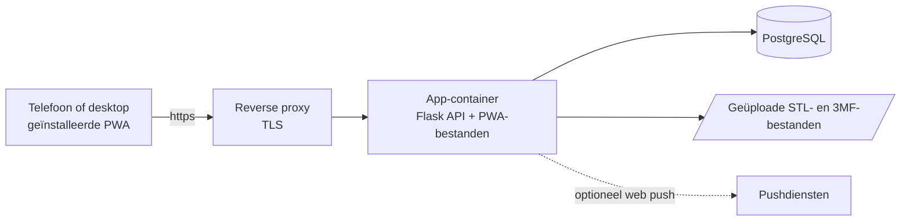

## Bijdragen

Bijdragen zijn welkom. De werkafspraken voor mensen en AI-assistenten staan in [AGENTS.md](AGENTS.md): versiebeheer, lokale controles, tests en de werkwijze voor pull requests. Voor bugs en ideeën kun je een [issue](https://github.com/Flux76HQ/3dprint_pricing/issues/new) openen.

```bash
python -m venv .venv && . .venv/bin/activate
pip install -r backend/requirements-dev.txt
python scripts/setup_hooks.py
cd backend && PYTHONPATH=. python -m pytest -q
```

De screenshots hierboven komen uit een demo-instance: na een wijziging die een scherm anders laat uitzien draai je `pip install playwright && python scripts/generate_screenshots.py` en commit je de bijgewerkte afbeeldingen in `docs/assets/`.

## Privacy & beveiliging

- Alles staat op je eigen server: geen account bij ons, geen analytics en geen tracking.
- Inloggen gaat met passkeys; de app ziet nooit een wachtwoord, tenzij je de optionele wachtwoord-login aanzet.
- Back-ups bevatten nooit inloggegevens (passkeys, herstelcodes, wachtwoorden, pushaanmeldingen).
- Meld beveiligingsproblemen rechtstreeks bij de beheerders (zie Contact) en niet in een openbare issue.

## Contact

**Flux76HQ** · [@Flux76HQ](https://github.com/Flux76HQ)

---

<div align="center">
<sub>Gemaakt met ❤️ in Nederland</sub>
</div>
