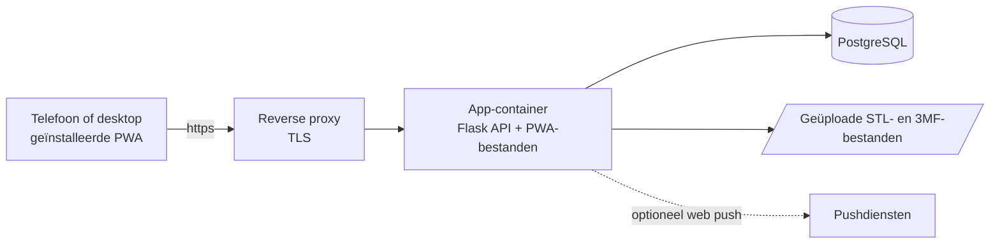

<div align="center">

🇬🇧 [English](README.md) · 🇳🇱 **Nederlands**


# 3D Print Pricing

**Een zelf-gehoste app voor wie 3D-prints verkoopt: reken uit wat een print echt kost, houd je filamentvoorraad bij en maak van bestellingen facturen.**

[](#installeren-als-app)
[](#installatie-self-hosted)
[](#functies)
[](#)

[Handleiding](docs/handleiding.md) · [Werkafspraken](AGENTS.md) · [Documentatie](docs/)

</div>

---

## Screenshots

<picture>
  <source media="(prefers-color-scheme: dark)" srcset="docs/assets/desktop-calculation-dark.png">
  
</picture>

### Desktop

| 3D Modellen | Filamentvoorraad | Bestellingen |
|:---:|:---:|:---:|
|  |  |  |

### iPhone: de iOS-look

De zwevende navigatiebalk met glaseffect. Op het beginscherm geïnstalleerd draait de app schermvullend onder de statusbalk.

| 3D Modellen | Kostprijs | Bestellingen | Filament |
|:---:|:---:|:---:|:---:|
|  |  |  |  |

### Android: de Android-look

De navigatiebalk over de volle breedte met een pil achter het actieve icoon.

| 3D Modellen | Kostprijs | Bestellingen | Filament |
|:---:|:---:|:---:|:---:|
|  |  |  |  |

### Instellingen en je eigen kleur

*Instellingen* is gegroepeerd in *Persoonlijk*, *Gegevens* en *Beheer*, elk onderdeel met een icoon (wat je ziet hangt af van je rol). Op een telefoon vormen de onderdelen een rij die je kunt vegen. Onder *Weergave* kies je de taal, licht of donker en je **accentkleur**: elf voorinstellingen, waaronder bordeaux en grafiet, of een kleur naar keuze. Het hele scherm kleurt mee, niet alleen de knoppen. Onder *Filamenten* klappen de blokken Spoolman en *Importeren en delen* in.

| Weergave: licht, met het standaardpaars | Weergave: donker, met teal |
|:---:|:---:|
|  |  |

| iPhone: instellingen | Android: instellingen |
|:---:|:---:|
|  |  |

### Filament: bibliotheek, import en nieuwe rollen

*Instellingen → Filamenten* bevat de filamentbibliotheek: voeg een filament toe, importeer een Bambu Lab-factuur, importeer of exporteer de bibliotheek als JSON, of synchroniseer haar met GitHub. Onder *Filament → Nieuwe rol* maak je een rol aan, met de hand, door de barcode te scannen of door een filament uit de bibliotheek te kiezen.

| Bibliotheek: import, export en synchronisatie | Nieuwe rol |
|:---:|:---:|
|  |  |

| iPhone: bibliotheek | iPhone: nieuwe rol | Android: bibliotheek | Android: nieuwe rol |
|:---:|:---:|:---:|:---:|
|  |  |  |  |

Onder *Instellingen → Weergave → Navigatiebalk* kies je iOS-achtig of Android-achtig, of laat je de instelling op *Automatisch*: de app herkent het toestel en kiest Android-achtig op Android en iOS-achtig op andere apparaten. Je keuze wordt bij je account bewaard en geldt op al je apparaten. Licht, donker en systeemthema en een eigen accentkleur zitten erbij.

<sub>De screenshots tonen demogegevens.</sub>

## Waarom 3D Print Pricing?

Wie 3D-prints verkoopt moet weten wat elke print kost: filament per gram, machinetijd, stroom, verpakking en een eerlijk deel van de aanschaf van de printer. Met een spreadsheet kom je een eind, tot de prijzen veranderen, de voorraad ongemerkt opraakt of een klant om een factuur vraagt. 3D Print Pricing houdt prijzen, voorraad en bestellingen bij elkaar op een plek die je zelf host, en werkt op je telefoon net zo goed als aan je bureau.

## Functies

- **Kostprijs in een paar seconden**: filament, onderdelen, accessoires (kabels, laders), printerafschrijving en energie tellen op tot een kostprijs, met optioneel een marge voor een adviesverkoopprijs. Elke regel wordt eerst op hele centen afgerond, zodat de regels op het scherm optellen tot het totaal.
- **Rechtstreeks uit de slicer**: koppel een `.3mf`- of `.stl`-bestand. Een gesliced 3MF (Bambu Studio / Orca) geeft de echte gram per filament en de printtijd, die automatisch in de berekening komen; een STL geeft een schatting van het gewicht.
- **Filamentbibliotheek**: leg de gegevens van de filamenten die je koopt vast (merk, type, kleur, filament-ID van de leverancier, gewicht, diameter, temperaturen, richtprijs), zodat een nieuwe rol zichzelf invult. Voeg een filament met de hand toe via *Filament toevoegen*, of vul de bibliotheek zonder te typen: **importeer** een Bambu Lab-factuur (PDF, inclusief barcodes), **importeer** een JSON-bestand, **voeg de rollen uit je filamentlijst toe** of **synchroniseer** de gedeelde bibliotheek met GitHub, en **draag bij** aan de centrale bibliotheek met een voorgevulde GitHub-issue. **Exporteer** de bibliotheek als JSON om haar te bewaren of naar een andere installatie te verplaatsen. JSON-import en synchroniseren voegen alleen toe en werken bij, verwijderen nooit, en vragen eerst een bevestiging met de aantallen; de bibliotheek bevat nooit twee keer hetzelfde filament en staat los van je voorraad.
- **Filamentvoorraad met barcodescanner**: je rollen met prijs, resterend gewicht, kleur en temperaturen, gegroepeerd per soort. **Maak een nieuwe rol aan** met de hand, door de barcode te scannen (een bekende rol vult zichzelf in), door een filament uit de bibliotheek te kiezen of, bij Bambu Lab, door soort en kleur uit de webshop te kiezen; een nieuwe rol kan zijn filament ook aan de bibliotheek toevoegen. Krijg een melding als een soort bijna op is en boek het verbruik van een berekening met één klik van de voorraad af.
- **Prijzen die blijven staan**: een opgeslagen berekening bewaart de prijzen van het moment van opslaan, dus een latere prijswijziging van een rol herschrijft je geschiedenis niet.
- **Zakelijk bruikbaar**: btw over de verkoopprijs, een marge en een afronding van de prijs per bestelling (op 5/10/50 cent, hele euro's of eindigend op ,95/,99, met je marge als minimum), en een knop om de kosten te blurren als een klant meekijkt.
- **Klanten, bestellingen en facturen**: klanten met klantnummer, bestellingen met meerdere prints, een status van *nieuw* tot *afgehandeld* en een factuur als PDF met je logo, een uniek factuurnummer en een SEPA-betaal-QR. Wil je je eigen briefpapier, dan kan dat als Word- of PDF-sjabloon.
- **Inloggen met passkeys**: geen wachtwoord dat kan lekken. Optioneel een wachtwoord met tweestapsverificatie, en herstelcodes voor noodgevallen.
- **Met meer dan één persoon**: een beheerder nodigt mensen uit met een link voor eenmalig gebruik en iedereen kiest zelf een passkey of wachtwoord, zodat niemand dat van een ander kent. Gewone gebruikers doen het dagelijkse werk; een beheerder beheert ook de gebruikers, de bedrijfsgegevens, back-ups en updates en kan een gewone gebruiker tot beheerder maken.
- **Een echte app op elk apparaat**: te installeren op het beginscherm van iPhone en Android en op de desktop, werkt met de camera en met meldingen, en spreekt Nederlands en Engels.
- **Jouw gegevens, jouw server**: back-up en herstel van alles vanuit de app, en je gegevens blijven op je eigen server. Onder *Instellingen → Systeem* zet je de app ook terug naar een nieuwe installatie: dat verwijdert alles in de database en de uploads (ook de passkeys), na een getypt woord en een verse bevestiging met passkey (of wachtwoord en code), en laat `.env`, de image en `DATA_PATH/backups` staan. Maak eerst een back-up als je het niet zeker weet.

De volledige beschrijving van elke functie staat in de [handleiding](docs/handleiding.md).

## Aan de slag

### Gebruikers

- 🌐 **Web:** open het adres van je eigen installatie. Passkeys vragen https en een domeinnaam.
- 📱 **iPhone / iPad:** zie [Installeren als app](#installeren-als-app).
- 🤖 **Android:** zie [Installeren als app](#installeren-als-app).
- 🐳 **Self-hosted:** zie [Installatie](#installatie-self-hosted).

### Installeren als app

- **Android (Chrome, Edge, Samsung Internet) en desktop:** open het https-adres en kies *Installeer de app* in de melding, of onder *Instellingen → Algemeen → App installeren*. Lang drukken op het icoon geeft snelkoppelingen (nieuwe berekening, filament).
- **iPhone / iPad:** open het https-adres in **Safari → Deel → Zet op beginscherm**. De app start dan schermvullend met een eigen icoon en opstartscherm, zonder pinch-zoom of zijwaarts vegen, als een native app.

### Installatie (self-hosted)

```bash
git clone https://github.com/Flux76HQ/3dprint_pricing.git
cd 3dprint_pricing
python scripts/init_env.py --port 6090 --domain print.voorbeeld.nl   # maakt .env met verse geheimen
docker compose up -d
```

`init_env.py` is de makkelijkste weg; `.env.example` kopiëren naar `.env` en aanpassen werkt net zo goed. Een server heeft alleen `docker-compose.yml` en `.env` nodig: de image wordt van `ghcr.io/flux76hq/3dprint_pricing` gepulld. Zonder `--domain` wordt `http://localhost:<poort>` ingesteld, genoeg om het uit te proberen.

Open daarna het adres en doorloop de onboarding:

1. Vul de **setupcode** en je naam in. De setupcode is de waarde achter `SETUP_CODE=` in het `.env`-bestand op je server (`init_env.py` toonde hem ook; `grep SETUP_CODE .env` toont hem opnieuw). Typ of plak hem in het veld *Setupcode* van het eerste scherm; je hebt hem alleen voor deze eerste keer nodig, daarna log je in met je passkey. Het onboarding-scherm legt dit ook uit.
2. Maak je **passkey** aan (vingerafdruk, gezicht of apparaatcode).
3. **Bewaar de 8 herstelcodes.** Ze worden één keer getoond en werken elk één keer.

Zet een reverse proxy met TLS voor de app en stel `RP_ID` en `RP_ORIGINS` in op dat domein: passkeys, installeren, de camera en meldingen werken alleen via https (behalve op `localhost`).

### Installatie als Home Assistant-app

Voeg op Home Assistant OS of Supervised `https://github.com/Flux76HQ/3dprint_pricing` toe onder **Instellingen > Apps > App installeren > Repositories** en
installeer *3D Print Pricing*: de app brengt zijn eigen PostgreSQL mee en bewaart zijn data in de map van de app, die Home Assistant meeneemt in zijn back-ups.
Passkeys vragen nog steeds een domein met https voor de poort van de app, dus vul `rp_id` in op het tabblad Configuratie. De stappen staan op het tabblad
Documentatie van de app ([`homeassistant/DOCS.md`](homeassistant/DOCS.md)). Voorlopig alleen amd64.

### Configuratie

Instellen in `.env`; het bestand `.env.example` documenteert elke waarde.

| Variabele | Verplicht | Standaard | Omschrijving |
|---|:---:|---|---|
| `WEB_PORT` | ✅ | - | Poort van de app; compose publiceert en de app luistert op deze waarde |
| `DATA_PATH` | ✅ | - | Map op de host voor alle data: de database (`postgres/`) en de geüploade bestanden (`uploads/`). Gewone mappen, geen Docker-volumes. Moet een **absolute** map van de Docker-host zijn (bijv. `/srv/printpricing`, op Unraid `/mnt/user/appdata/printpricing`), nooit `./data`; data die ergens anders terecht is gekomen verplaatst `scripts/migrate_data.sh` |
| `POSTGRES_USER` / `POSTGRES_PASSWORD` / `POSTGRES_DB` | ✅ | - | De database; gebruik een wachtwoord met alleen letters en cijfers |
| `RP_ID` | ✅ | - | Domein waarop de app draait, zonder schema of poort. Passkeys zijn eraan gebonden |
| `RP_ORIGINS` | ✅ | - | Volledige origin(s), komma-gescheiden, bijvoorbeeld `https://print.voorbeeld.nl`. Uitnodigingslinks gebruiken het adres waarop de beheerder is ingelogd als dat hier staat, anders het eerste |
| `SETUP_CODE` | ✅ | - | Eenmalige code voor de onboarding, zodat niet de eerste bezoeker de app overneemt |
| `SESSION_SECRET` | ✅ | - | Ondertekent sessiecookies, minimaal 32 tekens |
| `RP_NAME` | ❌ | `3D Print Pricing` | Naam die in de passkey-prompt staat |
| `SESSION_HOURS` | ❌ | `24` | Levensduur van een sessie |
| `MAX_UPLOAD_MB` | ❌ | `50` | Grootste STL/3MF-upload in MB |
| `VAPID_PUBLIC_KEY` / `VAPID_PRIVATE_KEY` | ❌ | leeg | Sleutelpaar voor push-meldingen (`python scripts/generate_vapid.py`); leeg betekent meldingen uit |
| `VAPID_SUBJECT` | ❌ | `mailto:admin@<RP_ID>` | Contactadres voor de pushdiensten |
| `AI_IMAGES_ENABLED` | ❌ | `FALSE` | Zet op `TRUE` om de optionele functie *AI-afbeeldingen* te tonen (productafbeeldingen uit een foto, gemaakt met OpenAI GPT Image). De API-sleutel voer je in de app in onder Instellingen, niet in `.env` |
| `FILAMENT_LIBRARY_URL` | ❌ | `library/filaments.json` van deze repository | Waar *Instellingen → Filamenten → Synchroniseren* de gedeelde filamentbibliotheek vandaan haalt: een JSON-bestand in het formaat van de bibliotheek-export, op `raw.githubusercontent.com`. Leeg zet de knop Synchroniseren uit |
| `SPOOLMAN_URL` | ❌ | leeg (vul het in de app in) | Het adres van je [Spoolman](https://github.com/Donkie/Spoolman) zoals de container van de app het bereikt, bijvoorbeeld `http://spoolman:8000` (zonder inlog). Daarmee leest *Instellingen → Filamenten → Synchroniseren* de rollen en wat er nog op zit uit Spoolman, wordt geboekt filament teruggemeld en kunnen de bibliotheek en je eigen rollen erheen worden gezet. Laat het leeg om het adres in de app in te vullen (beheerders, *Instellingen → Filamenten*); staat het hier, dan gaat dat voor en toont de app het alleen-lezen |
| `PROXY_HOPS` | ❌ | `0` | Aantal reverse proxies voor de app |
| `WEB_CONCURRENCY` | ❌ | `2` | Aantal Gunicorn-workers |
| `PRINTPRICING_UPDATE_CHECK` | ❌ | `true` | De updatecontrole: de app vraagt aan GitHub of er een nieuwere stabiele release is en meldt dat aan de eigenaar met een melding en onder *Instellingen → Systeem → Updatecontrole*. Er wordt niets over jouw installatie meegestuurd en er wordt nooit iets bijgewerkt. `false` (ook `0`, `no`, `off`) zet het uit, voor een installatie die niet naar buiten mag bellen. Een beta-build ziet alleen stabiele releases |
| `PRINTPRICING_TAG` | ❌ | `latest` | Welke build draait: `latest` (stabiel), `beta` (de ontwikkelversie) of een versienummer zoals `0.26.15`. `docker-compose.yml` pullt `ghcr.io/flux76hq/3dprint_pricing:<tag>` en geeft dezelfde waarde aan de app, die op `beta` een **beta**-label naast zijn naam toont. Vervangt `APP_IMAGE` |

Bijwerken doe je met `docker compose pull && docker compose up -d` (of `sh scripts/update.sh`, dat eerst de database dumpt). De app meldt zelf dat er een nieuwere release is: hij vraagt het aan GitHub (de nieuwste stabiele release van deze repository, er wordt niets over jouw installatie meegestuurd) en toont een melding en *Instellingen → Systeem → Updatecontrole*; hij meldt alleen en werkt nooit zelf bij. `PRINTPRICING_UPDATE_CHECK=false` zet het uit. Health checks, back-up, meldingen en al het andere over het draaiende houden van de app staan in de [handleiding](docs/handleiding.md).

## Tech stack

- **App / frontend:** een Progressive Web App in gewoon JavaScript, zonder buildstap, met een service worker voor de offline schil
- **Backend:** Python, Flask en Gunicorn; passkeys via de open-source bibliotheek `py_webauthn` (pakket `webauthn`)
- **Database:** PostgreSQL 17, met alleen-vooruit migraties die op checksum bewaakt worden
- **Infrastructuur:** Docker Compose, een image die CI naar GHCR publiceert

## Architectuur



## Bijdragen

Bijdragen zijn welkom. Pull requests gaan naar de branch `beta`, nooit rechtstreeks naar `main`; `main` is de stabiele lijn en krijgt alleen een promotie-pull-request vanuit `beta`. De werkafspraken voor mensen en AI-assistenten staan in [AGENTS.md](AGENTS.md): versiebeheer, lokale controles, tests en de werkwijze voor pull requests. Voor bugs en ideeën kun je een [issue](https://github.com/Flux76HQ/3dprint_pricing/issues/new) openen.

```bash
python -m venv .venv && . .venv/bin/activate
pip install -r backend/requirements-dev.txt
python scripts/setup_hooks.py
cd backend && PYTHONPATH=. python -m pytest -q
```

De screenshots hierboven komen uit een demo-instance: na een wijziging die een scherm anders laat uitzien draai je `pip install playwright && python scripts/generate_screenshots.py` en commit je de bijgewerkte afbeeldingen in `docs/assets/`.

### Stabiel en beta

| | Stabiel | Beta |
|---|---|---|
| Branch | `main` | `beta` |
| Image | `ghcr.io/flux76hq/3dprint_pricing:latest` (en `X.Y.Z`) | `ghcr.io/flux76hq/3dprint_pricing:beta` |
| GitHub-release | `vX.Y.Z` | geen |

Elke wijziging komt eerst in `beta`, en elke push naar `beta` bouwt een nieuwe beta-image. Pas als de beta zich bewijst, wordt hij gepromoveerd naar `main`, wat `VERSION` ophoogt en `latest` en de release bouwt. Om de beta te proberen zet je `PRINTPRICING_TAG=beta` in `.env` (de app toont dan een **beta**-label naast zijn naam) en draai je `docker compose pull && docker compose up -d`; gebruik daarvoor een aparte datamap.

## Privacy & beveiliging

- Alles staat op je eigen server: geen account bij ons, geen analytics en geen tracking.
- Inloggen gaat met passkeys; de app ziet nooit een wachtwoord, tenzij je de optionele wachtwoord-login aanzet.
- Back-ups bevatten nooit inloggegevens (passkeys, herstelcodes, wachtwoorden, pushaanmeldingen) of uitnodigingen. Een uitnodigingslink wordt één keer getoond en alleen de hash ervan wordt bewaard.
- Meld beveiligingsproblemen rechtstreeks bij de beheerders (zie Contact) en niet in een openbare issue.

## Contact

**Flux76HQ** · [@Flux76HQ](https://github.com/Flux76HQ)

---

<div align="center">
<sub>Gemaakt met ❤️ in Nederland</sub>
</div>
